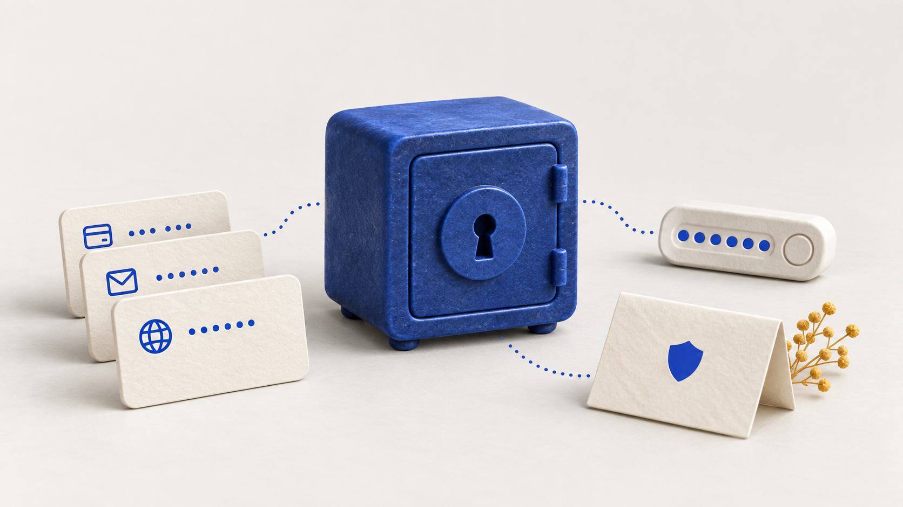
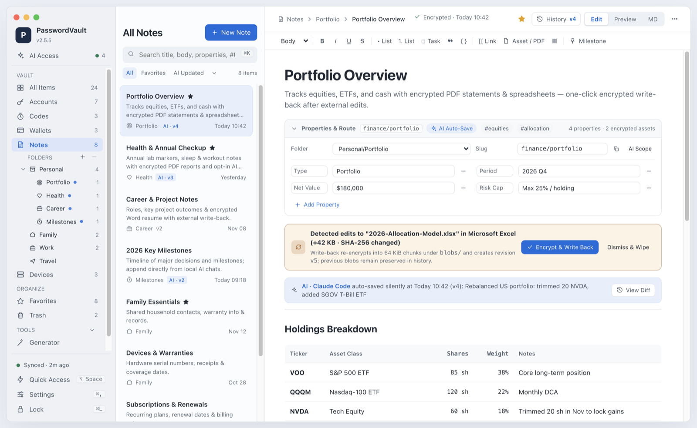
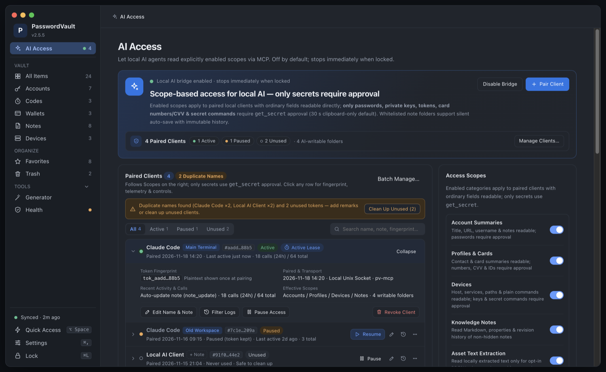
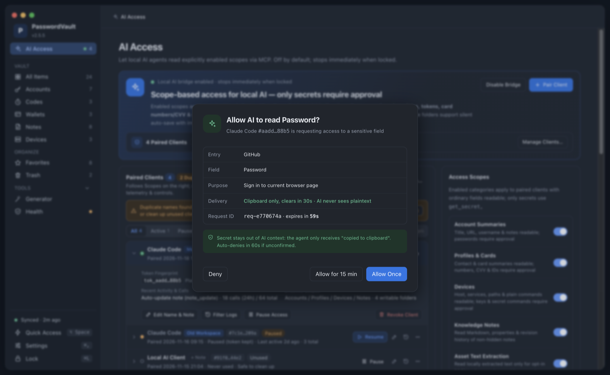
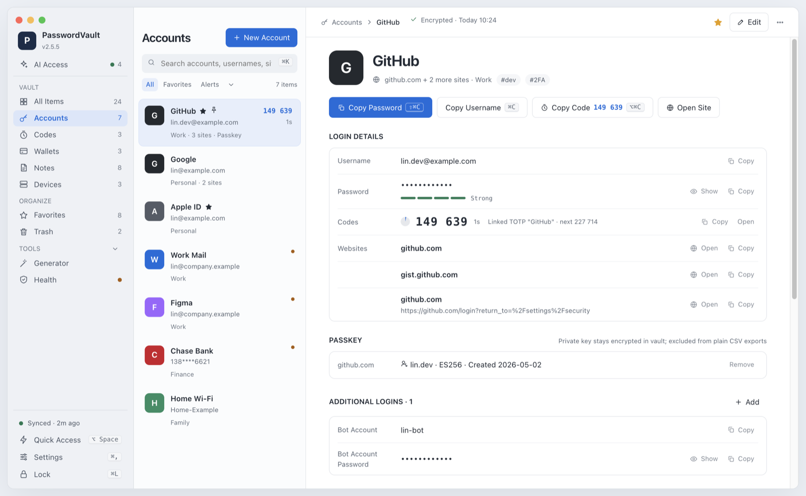
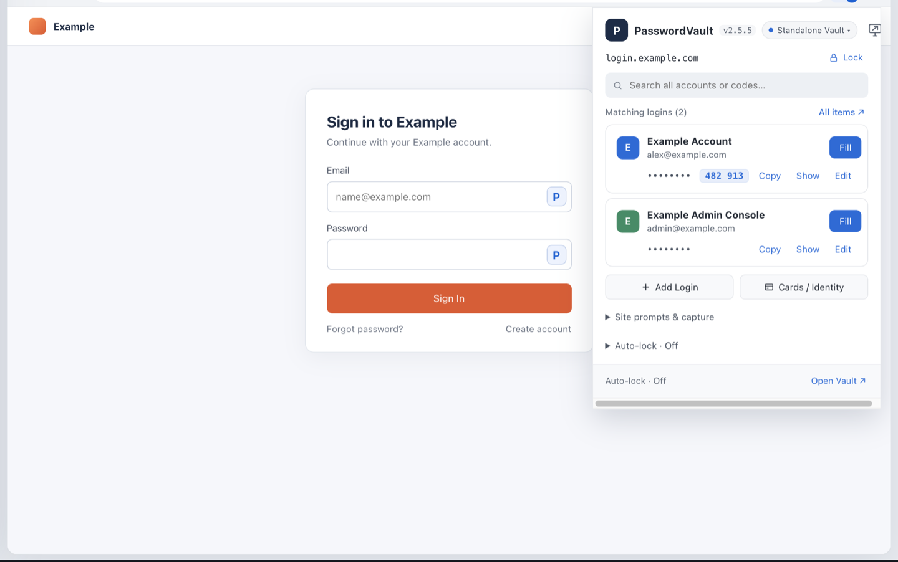
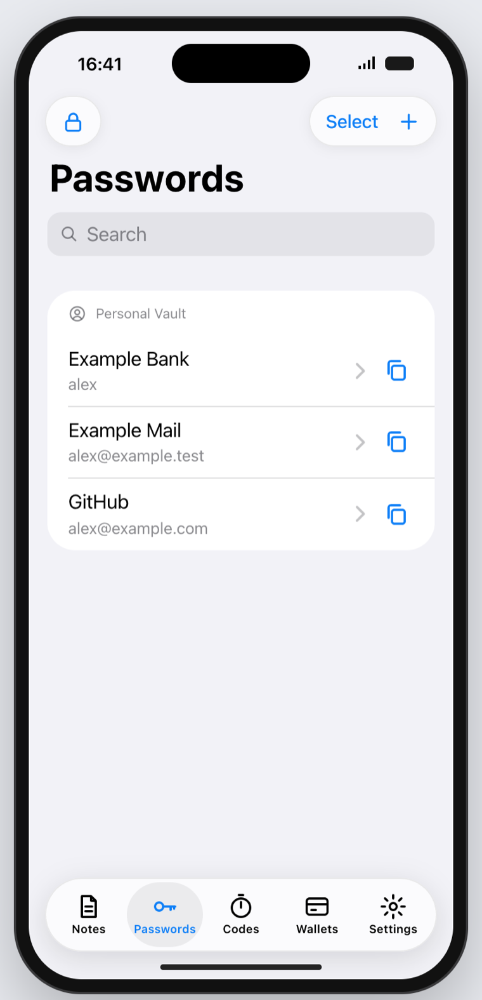
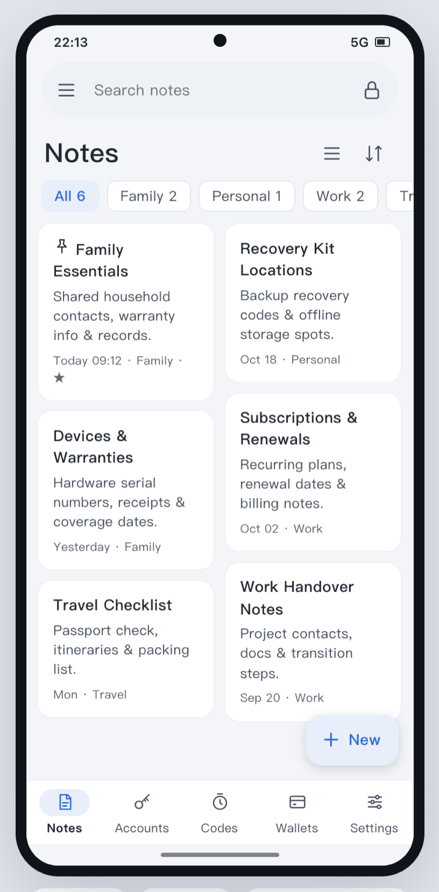
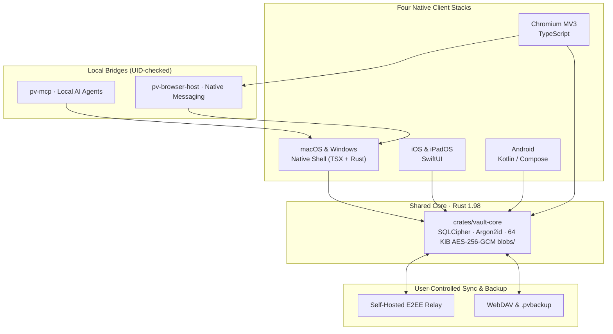

<div align="center">
  <p>
    
  </p>

  <h1>PasswordVault</h1>
  <p><strong>Local-first encrypted vault for passwords, knowledge, and AI-safe credentials.</strong></p>

  <p>
    <a href="https://github.com/JunWeiUp/PasswordVault/releases/tag/v2.5.6"></a>
    <a href="https://github.com/JunWeiUp/PasswordVault/stargazers"></a>
    <a href="LICENSE"></a>
    <a href="#architecture"></a>
    <a href="#download"></a>
    <a href="#local-ai-mcp"></a>
  </p>

  <p><strong>English</strong> · <a href="README.zh-CN.md">简体中文</a></p>
  <p>
    <a href="#gallery">Gallery</a> ·
    <a href="#local-ai-mcp">Local AI (MCP)</a> ·
    <a href="#architecture">Architecture</a> ·
    <a href="#download"><strong>Download</strong></a> ·
    <a href="#security">Security</a> ·
    <a href="#run-from-source">Build</a>
  </p>
</div>

> [!IMPORTANT]
> **Developer preview (`v2.5.6`).** Independent security audit pending — evaluate with fictional data only. All artwork and screenshots below use synthetic sample data.

---

## Gallery

### Encrypted Notes & 100 MB Chunked Assets
Hierarchical folders, structured properties, `[[wikilinks]]`, diff history, and 64 KiB AES-256-GCM chunked files (`blobs/`) with one-click external edit write-back.

<p align="center">
  
</p>

### Local AI (MCP)
Category-level access for local AI agents (Claude Code, Codex, Cursor) with client fingerprints, remarks, pause/resume, and one-click unused token cleanup.

<p align="center">
  
</p>

<table>
  <tr>
    <td width="50%" align="center" valign="top">
      
      <br><sub><strong>Zero-prompt-leak secret approval</strong> · Clipboard-only (30 s clear)</sub>
    </td>
    <td width="50%" align="center" valign="top">
      
      <br><sub><strong>Accounts, live TOTP & passkeys</strong> · Multi-login & password history</sub>
    </td>
  </tr>
</table>

### Browser & Mobile

<p align="center">
  
  <br><sub><strong>Chromium MV3 Extension</strong> · Explicit fill & save, live TOTP, native Mac sync or standalone vault</sub>
</p>

<table>
  <tr>
    <td width="50%" align="center" valign="top">
      
      <br><sub><strong>iOS / iPadOS</strong> · SwiftUI + AutoFill</sub>
    </td>
    <td width="50%" align="center" valign="top">
      
      <br><sub><strong>Android</strong> · Kotlin / Compose + Autofill</sub>
    </td>
  </tr>
</table>

---

## Local AI (MCP)

| Tier | Policy |
| --- | --- |
| **Ordinary fields** | Direct read across enabled scopes (`accounts`, `profiles`, `devices`, `notes`) |
| **Writes** | `create` / `update` / `delete` without approval, ≤ 10 per minute per client; every write is an encrypted history revision and `delete` only moves to the Trash |
| **Passwords, keys, card numbers & secret commands** | Per-request native approval (`read` with `field`) · **clipboard-only 30 s default** |
| **Wallets, seed phrases & TOTP** | **Never exposed** |

<details>
<summary><strong>One-click MCP config & 5 built-in tools</strong></summary>

```json
{
  "mcpServers": {
    "passwordvault": {
      "command": "/Applications/PasswordVault.app/Contents/MacOS/pv-mcp",
      "env": {
        "PV_AI_SOCKET": "~/Library/Application Support/PasswordVaultNSHPreview/ai/mcp.sock",
        "PV_AI_TOKEN": "<issued-once-on-pair>"
      }
    }
  }
}
```

`find` · `read` · `create` · `update` · `delete` (defined in `apps/desktop/src/ai/tools.schema.json`) — see [apps/desktop/src/ai/README.md](apps/desktop/src/ai/README.md).

</details>

---

## Architecture



---

## Download

Latest preview: [**v2.5.6 Release**](https://github.com/JunWeiUp/PasswordVault/releases/tag/v2.5.6) · [Install notes](config/release/INSTALL.md) · [Release notes](config/release/NOTES.md)

| Package | Target |
| --- | --- |
| **macOS ZIP** | macOS 14+ (Apple Silicon) · includes signed `pv-mcp` & `pv-browser-host` |
| **Windows x64 ZIP** | Windows 10/11 x64 portable preview |
| **Android ARM64 APK** | Android 8.0+ with system Autofill |
| **iOS Simulator ZIP** | iOS 16+ / iPadOS 16+ (Simulator only) |
| **Chromium Extension ZIP** | Load unpacked in `chrome://extensions` or `edge://extensions` |

---

## Security

- **Encryption:** SQLCipher / authenticated storage, Argon2id key wrapping, 64 KiB AES-256-GCM chunked `blobs/` with AAD.
- **Zero-trace sessions:** No plaintext master password on disk; 30 s concealed clipboard clear; `0700` anti-Spotlight/Time-Machine temp sessions wiped on lock.
- **User-owned sync:** Self-hosted E2EE relay (QR-joined symmetric device groups, older revisions kept in history) and user-controlled WebDAV.
- **Preview limits:** Independent audit and app-store distribution still in progress. Never attach real credentials or vault exports to issues.

---

## Run from source

Requires pinned **Rust 1.98.0**:

```bash
git clone https://github.com/JunWeiUp/PasswordVault.git
cd PasswordVault
bash tool/check_native.sh core
bash tool/check_native.sh macos
bash tool/check_native.sh browser
```

<details>
<summary><strong>Platform guides & repository map</strong></summary>

- **Desktop (Mac & Windows):** [apps/desktop/README.md](apps/desktop/README.md) · [tool/windows-desktop/README.md](tool/windows-desktop/README.md)
- **Mobile & Browser:** [apps/android/README.md](apps/android/README.md) · [apps/ios/README.md](apps/ios/README.md) · [apps/browser/](apps/browser/) · [apps/desktop/src/browser/README.md](apps/desktop/src/browser/README.md)
- **Structure & Notices:** [apps/README.md](apps/README.md) · [config/release/THIRD_PARTY_NOTICES.md](config/release/THIRD_PARTY_NOTICES.md)

</details>

---

## License

[MIT](LICENSE) — if you like local-first + Rust + AI-safe vaults, a ⭐ helps more people find the project.
