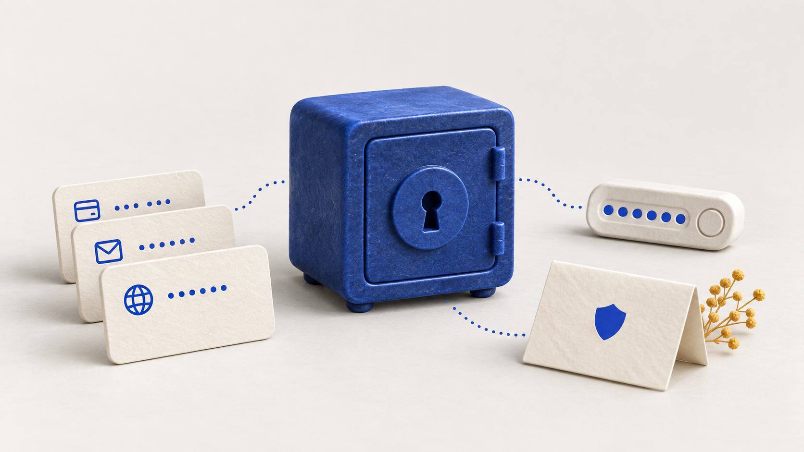
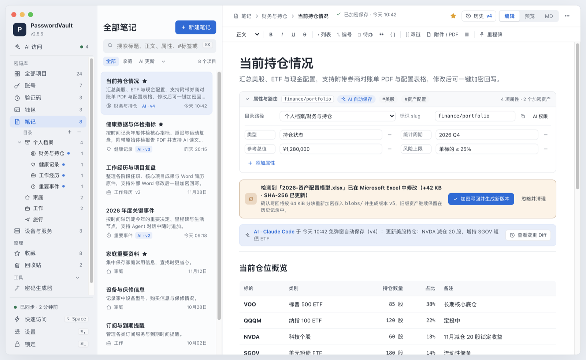
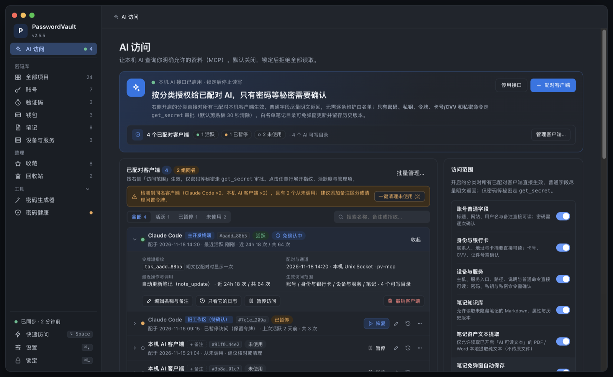
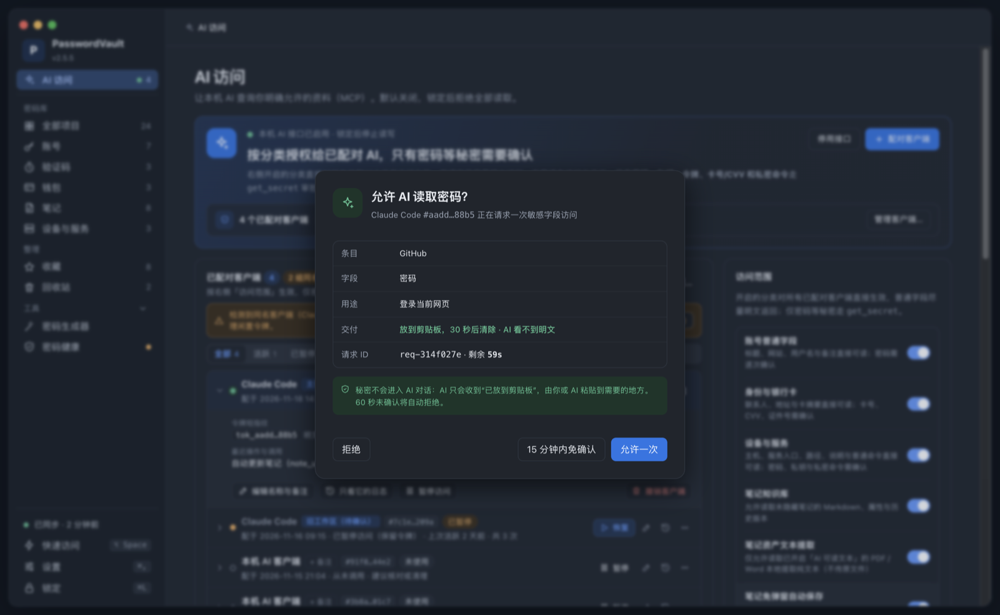
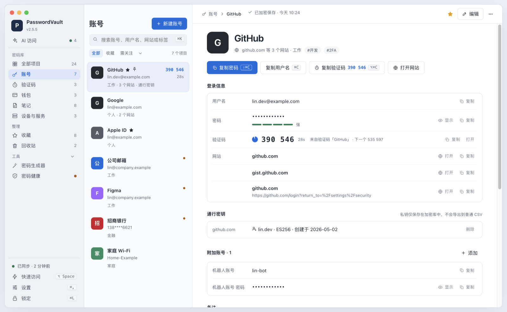
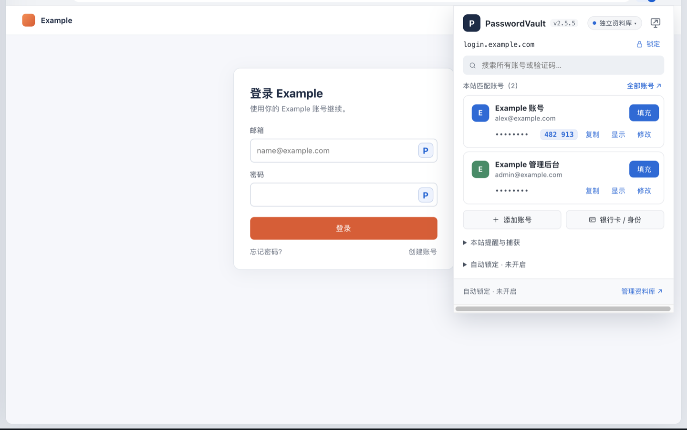
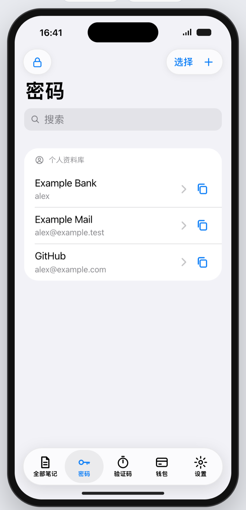
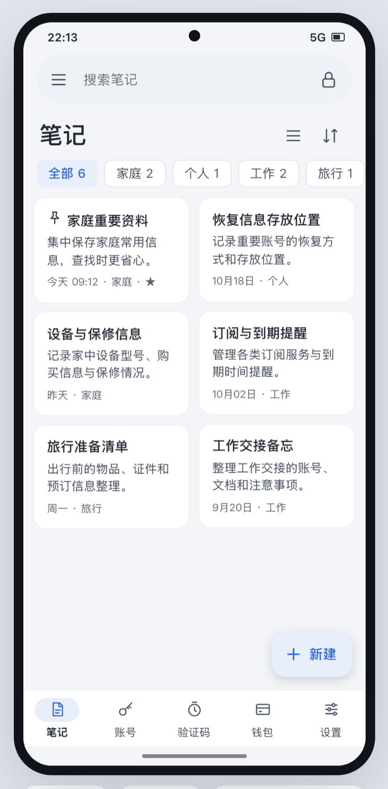
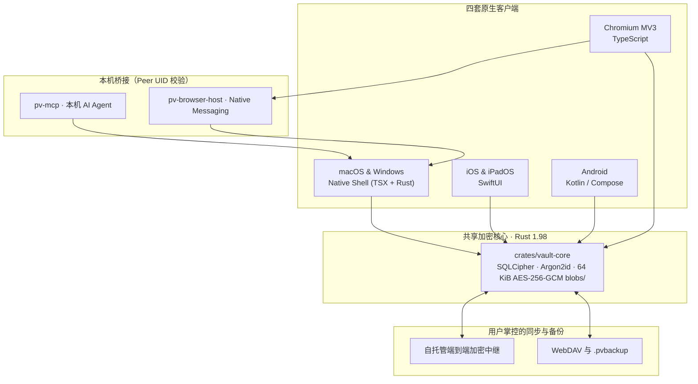

<div align="center">
  <p>
    
  </p>

  <h1>PasswordVault</h1>
  <p><strong>本地优先的加密资料库：集密码管理、个人知识库与安全 AI 接入于一体。</strong></p>

  <p>
    <a href="https://github.com/JunWeiUp/PasswordVault/releases/tag/v2.5.6"></a>
    <a href="https://github.com/JunWeiUp/PasswordVault/stargazers"></a>
    <a href="LICENSE"></a>
    <a href="#架构"></a>
    <a href="#下载"></a>
    <a href="#本机-ai-mcp"></a>
  </p>

  <p><a href="README.md">English</a> · <strong>简体中文</strong></p>
  <p>
    <a href="#界面预览">界面预览</a> ·
    <a href="#本机-ai-mcp">本机 AI (MCP)</a> ·
    <a href="#架构">架构</a> ·
    <a href="#下载"><strong>下载</strong></a> ·
    <a href="#安全边界">安全</a> ·
    <a href="#源码构建">构建</a>
  </p>
</div>

> [!IMPORTANT]
> **开发预览版（`v2.5.6`）。** 尚未完成独立安全审计，请仅使用虚构数据评估。下方主视觉与截图均使用虚构示例数据。

---

## 界面预览

### 加密个人知识库与 100 MB 分块资产
层级目录、结构化属性、`[[双链]]`、Diff 版本历史，以及 64 KiB 分块加密附件（`blobs/`）与外部编辑一键写回。

<p align="center">
  
</p>

### 本机 AI（MCP）与客户端管理
按分类开放普通字段给本机 AI（Claude Code / Codex / Cursor），支持指纹区分、加密备注、暂停/恢复与一键清理闲置令牌。

<p align="center">
  
</p>

<table>
  <tr>
    <td width="50%" align="center" valign="top">
      
      <br><sub><strong>密码不进 AI 上下文</strong> · 逐次弹窗审批，30 秒仅剪贴板交付</sub>
    </td>
    <td width="50%" align="center" valign="top">
      
      <br><sub><strong>账号、实时 2FA 与通行密钥</strong> · 多登录与密码历史</sub>
    </td>
  </tr>
</table>

### 浏览器插件与移动端

<p align="center">
  
  <br><sub><strong>Chromium MV3 插件</strong> · 显式确认填充与保存、实时 2FA、支持连 Mac 或独立资料库</sub>
</p>

<table>
  <tr>
    <td width="50%" align="center" valign="top">
      
      <br><sub><strong>iOS / iPadOS</strong> · SwiftUI + 系统自动填充</sub>
    </td>
    <td width="50%" align="center" valign="top">
      
      <br><sub><strong>Android</strong> · Kotlin / Compose + 系统自动填充</sub>
    </td>
  </tr>
</table>

---

## 本机 AI (MCP)

| 分级 | 策略 |
| --- | --- |
| **普通字段** | 已开启分类（`accounts` / `profiles` / `devices` / `notes`）直接可读 |
| **写入** | `create` / `update` / `delete` 无需审批，每个客户端每分钟最多 10 次；每次写入都留加密历史，`delete` 只移入回收站 |
| **密码、私钥、卡号与私密命令** | 逐次原生弹窗审批（`read` 带 `field`）· **默认仅剪贴板 30 秒清除** |
| **钱包、助记词与 TOTP** | **永不开放** |

<details>
<summary><strong>一键 MCP 配置与 5 个内置工具</strong></summary>

```json
{
  "mcpServers": {
    "passwordvault": {
      "command": "/Applications/PasswordVault.app/Contents/MacOS/pv-mcp",
      "env": {
        "PV_AI_SOCKET": "~/Library/Application Support/PasswordVaultNSHPreview/ai/mcp.sock",
        "PV_AI_TOKEN": "<配对时仅显示一次>"
      }
    }
  }
}
```

`find` · `read` · `create` · `update` · `delete`（定义见 `apps/desktop/src/ai/tools.schema.json`）— 详见 [apps/desktop/src/ai/README.md](apps/desktop/src/ai/README.md)。

</details>

---

## 架构



---

## 下载

最新预览：[**v2.5.6 Release**](https://github.com/JunWeiUp/PasswordVault/releases/tag/v2.5.6) · [安装说明](config/release/INSTALL.md) · [发行说明](config/release/NOTES.md)

| 产物 | 适用平台 |
| --- | --- |
| **macOS ZIP** | macOS 14+（Apple Silicon）· 含签名 `pv-mcp` 与 `pv-browser-host` |
| **Windows x64 ZIP** | Windows 10/11 x64 便携预览版 |
| **Android ARM64 APK** | Android 8.0+，支持系统自动填充 |
| **iOS Simulator ZIP** | iOS 16+ / iPadOS 16+（仅限模拟器） |
| **Chromium Extension ZIP** | 在 `chrome://extensions` 或 `edge://extensions` 加载解压目录 |

---

## 安全边界

- **静态加密：** SQLCipher / 认证加密，Argon2id 包装根密钥，64 KiB AES-256-GCM 分块 `blobs/`（带 AAD 校验）。
- **无痕清理：** 不存明文主密码；敏感剪贴板 30 秒自动清除；外部编辑临时目录 `0700` 防索引/备份并在锁库时清空。
- **自主同步：** 自托管端到端加密中继（扫码入组、旧版留存历史）与自控 WebDAV 备份。
- **当前限制：** 独立审计与商店发行仍在进行中，请勿在 Issue 中附上真实凭据或导出文件。

---

## 源码构建

需要固定工具链 **Rust 1.98.0**：

```bash
git clone https://github.com/JunWeiUp/PasswordVault.git
cd PasswordVault
bash tool/check_native.sh core
bash tool/check_native.sh macos
bash tool/check_native.sh browser
```

<details>
<summary><strong>各平台指南与目录说明</strong></summary>

- **桌面端（Mac / Windows）：** [apps/desktop/README.md](apps/desktop/README.md) · [tool/windows-desktop/README.md](tool/windows-desktop/README.md)
- **移动端与插件：** [apps/android/README.md](apps/android/README.md) · [apps/ios/README.md](apps/ios/README.md) · [apps/browser/](apps/browser/) · [apps/desktop/src/browser/README.md](apps/desktop/src/browser/README.md)
- **结构与许可：** [apps/README.md](apps/README.md) · [config/release/THIRD_PARTY_NOTICES.md](config/release/THIRD_PARTY_NOTICES.md)

</details>

---

## 许可证

[MIT](LICENSE) — 如果你喜欢「本地优先 + Rust 核心 + 安全 AI 协作」，欢迎点个 ⭐ Star 支持！
